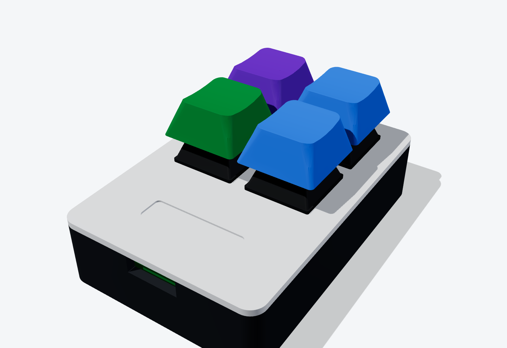
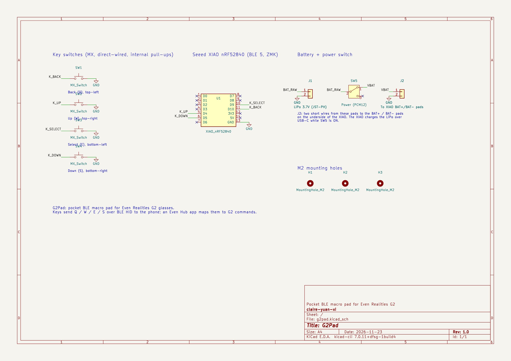
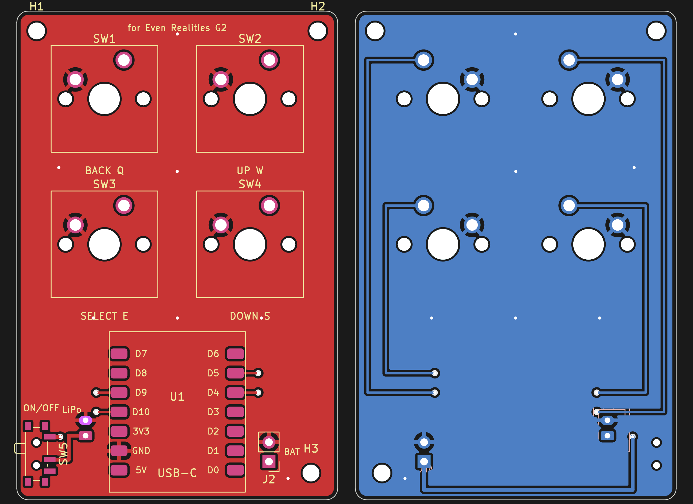
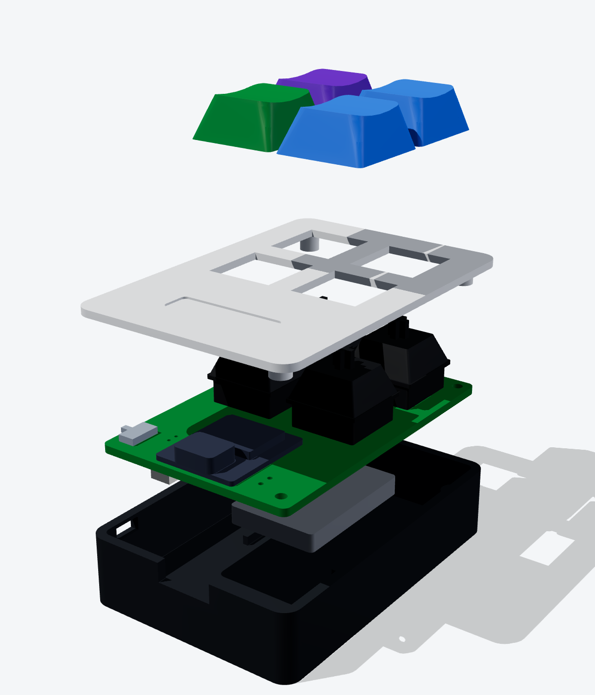
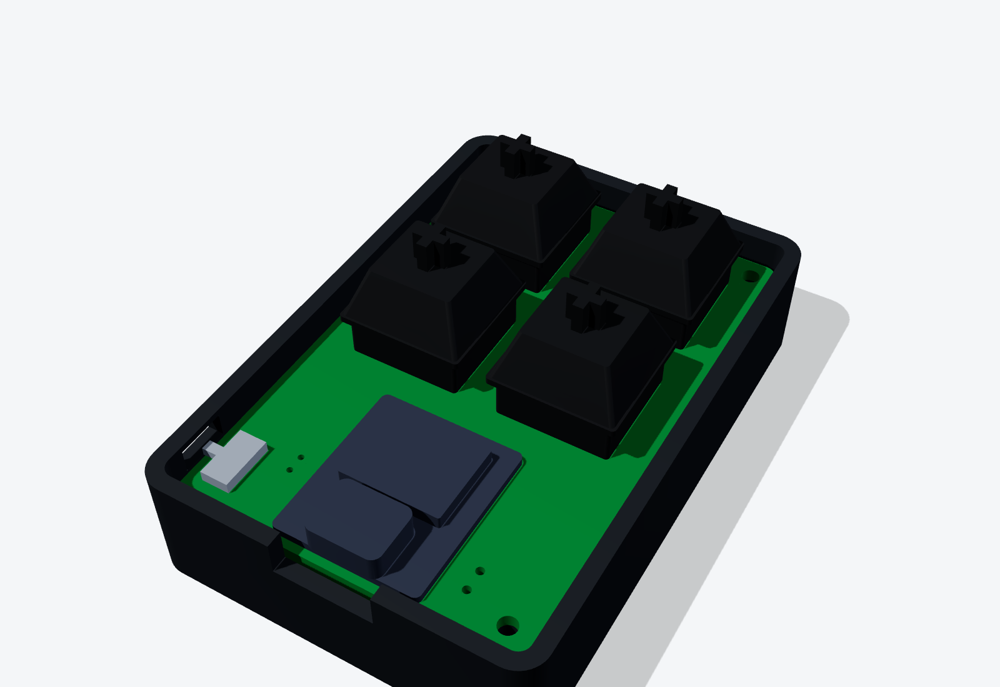

# G2Pad

**TLDR: A pocket-sized, four-key Bluetooth macro pad for the Even Realities G2 smart glasses.**

Hiya! G2Pad is a pocket-sized wireless macro pad for my new Even Realities G2 smart glasses, using four official GitHub keycaps (not illustrated in the render). The goal is to create a compact, physical alternative to the glasses' existing touch and ring controls, making it easier to navigate and interact with custom applications (that will also be made soon in the near future!)



| | |
|---|---|
| Size | 47 × 69 × 16 mm case (about 28 mm tall with keycaps) |
| Brain | Seeed Studio XIAO nRF52840 (Bluetooth LE 5, USB-C charging) |
| Keys | 4 × MX-style switches + official GitHub keycaps |
| Power | 150 mAh LiPo, on/off slide switch, charges over USB-C |
| Firmware | [ZMK](https://zmk.dev) (open-source wireless keyboard firmware)|

## Why I made it

The G2 is conventionally controlled with taps and swipes on the sides of the glasses or with the R1 smart ring. Those work, but they are fiddly when you are walking, wearing gloves, presenting, or trying to move through a long menu in a custom app. Plus, the popular R1 ring is an extra $250 on top of the existing $600+ price tag of the glasses themselves with prescriptions. I wanted to make the cheaper alternative, while also providing better physical feedback for controls.

## How to use it

1. Slide the power switch on the left side to **ON**.
2. On your phone, open Bluetooth settings and pair with **G2Pad** (it shows up like a keyboard).
3. Open a G2 app built to listen for G2Pad keys (see [How it talks to the glasses](#how-it-talks-to-the-glasses)).
4. Press keys:

```
 +-------------+-------------+
 |  BACK   (Q) |  UP     (W) |     tap:  send the letter
 |  hold: H    |             |     hold: long-press action
 +-------------+-------------+
 |  SELECT (E) |  DOWN   (S) |
 |  hold: M    |             |
 +-------------+-------------+
```

| Key | Tap | Hold (> 0.4 s) |
|---|---|---|
| Back (top-left) | `Q`, go back | `H`, go home |
| Up (top-right) | `W`, scroll / move up | |
| Select (bottom-left) | `E`, confirm | `M`, shortcut / menu |
| Down (bottom-right) | `S`, scroll / move down | |
| Up + Down together | toggle **Nav mode**: arrows, Enter, Esc | |
| Hold Back + Select | Bluetooth layer: Up = next paired device, Down = forget pairing | |

The keys send plain letters (Q, W, E, S) instead of special keys, which I found phones pass through a lot more reliably. Charge the pad by plugging USB-C into the XIAO with the switch ON. After 15 minutes idle it sleeps to save energy, to which you can wake it up again by clicking any key.

## How it talks to the glasses

```
[G2Pad] --BLE keyboard (HID)--> [phone] --> [Even Hub app (web app in the Even app)] --Even Hub SDK--> [G2 display]
```

The G2 has no keyboard input of its own, so the phone serves as the middleman. G2Pad pairs with the phone as a normal Bluetooth keyboard through an Even Hub app I will build. Even Hub apps are web apps that the Even Realities app runs in a WebView on the phone; they draw to the glasses through the Even Hub SDK ([Even Hub architecture](https://hub.evenrealities.com/docs/get-started/architecture)). The plan is for my G2 app to listen for the Q/W/E/S key presses and turn them into G2 actions (scroll, select, back).

### Schematic



Each switch connects one XIAO pin to ground and uses the chip's internal pull-up, so there is no matrix and no diodes.

### PCB



A 2-layer, 42 × 64 mm board with ground pours on both sides. Fabrication files are in [`pcb/gerbers.zip`](pcb/gerbers.zip), ready to upload to JLCPCB or any other fab.

### Case



Two 3D-printed parts:

* **Bottom tray**: holds the LiPo under the PCB, has three standoffs, a USB-C opening, a slot for the power switch, and a lanyard hole.
* **Top plate**: a 1.5 mm switch plate set at the MX standard height (5 mm above the PCB). It has screw bosses, plus a pocket on its underside for the XIAO.

Three M2 × 12 screws go up through the tray and the PCB into the plate bosses, clamping everything together. 



## Firmware

G2Pad runs ZMK as a custom shield (`g2pad`) on the `xiao_ble` board. The GitHub Actions workflow I built in [`.github/workflows/build.yml`](.github/workflows/build.yml) builds the firmware on every push for convenience. 

To change what the keys do, you can edit [`firmware/g2pad.keymap`](firmware/g2pad.keymap). 

## Bill of materials

See [BOM.csv](BOM.csv) for links!
